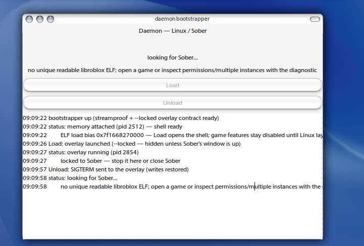

# Baseline 009 — 2026-10-20

**This is the reference point.** The first Daemon build that has ever linked and
run on the operator's Void box (`sd@66`). Tagged `baseline-009` in Git; the tag
points at `8adc9bc` (source `34091b9` + the payload file). Everything after this
is measured against it.

## What version this is

| Thing | Value |
|---|---|
| source commit | `34091b9` (the 2log.txt link fix + completed link-seam gate) |
| payload | `mirror/files/daemon-linux-009.txt` (committed `8adc9bc`) |
| courier run | 30 (`mirror-upload`), `E2E=PASS`, host `cnet` |
| FILE sha256 | `80ea52c9d69d77a8901b83167d8094e2464e455d78a6aceecfc8a25724c078a6` |
| ARCHIVE sha256 | `b943921e777c7bc86dab6dd31f73fc2591e8033cdeacc4115b80d492bb5f0356` |
| tree | 167 files, same shape as payload 008 |

## What the operator receipt proves (live, not inferred)

Receipt pasted 2026-10-20 — every gate green:

- `xbps-fetch` → `sha256sum` matched the state.json FILE sha exactly
- `DAEMON_LINUX_009_DONE=YES`, ARCHIVE + PAYLOAD shas matched, 167 files
- `setup.sh`: `[setup] build OK`, `BUILD_DONE=YES`, `BOOT_DONE=YES` —
  **the 2log.txt undefined-symbol flood is gone in production**; both
  `build/daemon` (2.0M) and `build/daemon-boot` were produced
- bootstrapper live: attached pid 2512 (`memory attached — shell ready`,
  ELF load bias 0x7f1668270000), **Load spawned the overlay (pid 2854)
  with the `--locked` contract**, Unload delivered SIGTERM and the restore
  path ran (`writes restored`) — the whole dx9ware lifecycle worked
- `daemon-boot --check` honesty + the doctor's once-per-boot yama fix
  (`ptrace_scope 1 → 0`) applied
- `install.sh` placed `~/.local/bin/daemon-boot` + `daemon`, desktop entry,
  icons

## Known gaps at the baseline (the honest list)

1. **The overlay never appeared over Sober.** Load launched the process and
   the manager owned it, but no window ever showed. The setup demo run of
   `daemon` names the likely cause, verbatim:
   `SDL_GL_CreateContext failed: Could not make GL context current:
   BadMatch (invalid parameter attributes) — headless` →
   `HAS_SDL_OVERLAY=1 but no display/context — falling to headless timer`.
   The same failure under Load means the "overlay" ran log-only with no
   window at all. This is the first thing to fix after the baseline.
2. **A crash "on a baseplate".** Which process died (the overlay vs Sober)
   is not yet pinned; the bootstrapper does not capture the overlay's
   stdout, so a crash leaves no log. Diagnostic gap + crash, both owed.
3. The README feature-table ❓ rows remain unverified (unchanged from
   `docs/LIVE_CHECKLIST.md`).

## Doctrine

Frozen mirror mechanism untouched (`sh scripts/frozen-tools.sh` =
`function-unchanged` before and after the payload). Updates ship only as
new `mirror/files/` payloads (template rule 1.5 / 12.8).
