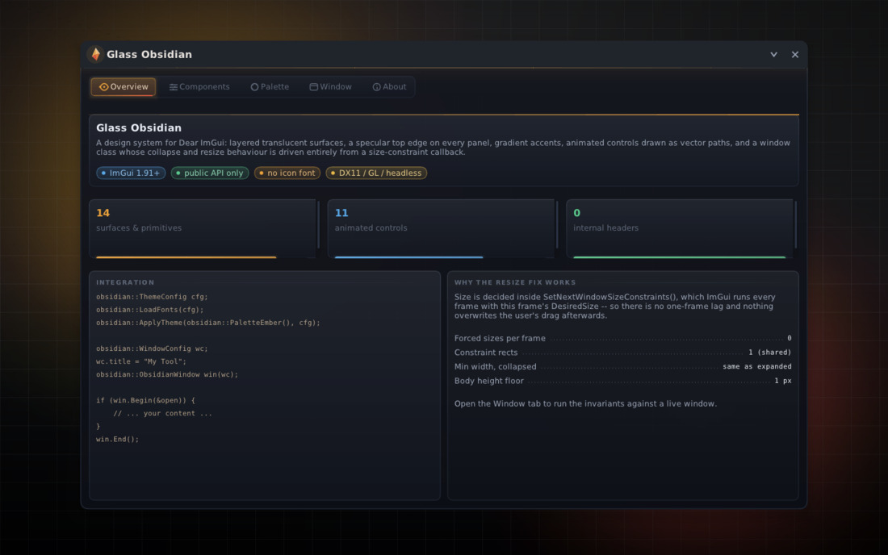
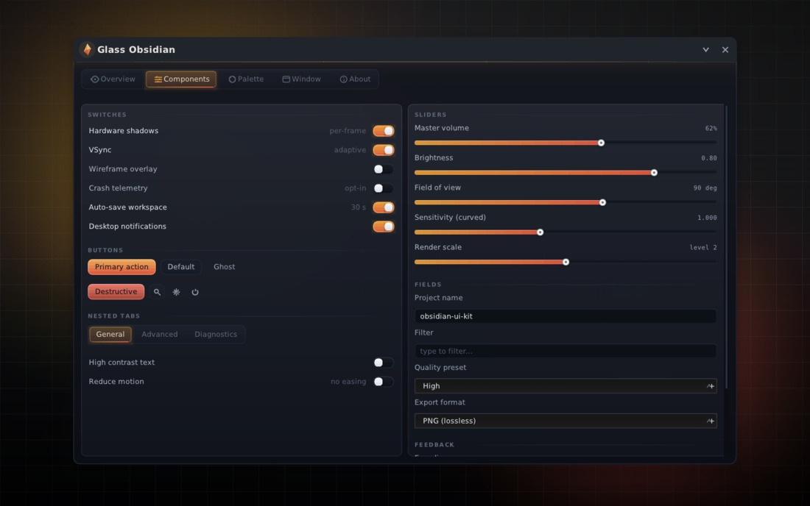
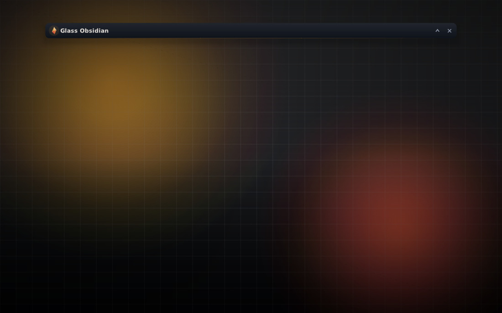
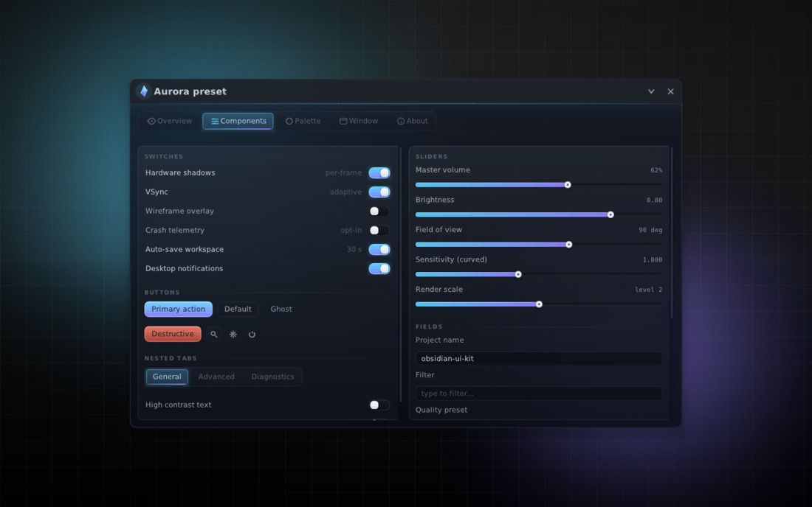

# Glass Obsidian

A **collapse-safe window class** and a **layered glass/obsidian theme** for
[Dear ImGui](https://github.com/ocornut/imgui) 1.91, written against the *public*
ImGui API. It exists to answer two problems at once:

1. **"My menu resizes wrong when it's collapsed."** Level-triggered size forcing
   (`SetNextWindowSize(..., Cond_Always)`), constraint rects that lag one frame
   behind the state they depend on, and min-widths that differ between collapsed
   and expanded states are the usual suspects. `obsidian::ObsidianWindow` removes
   all three by construction (see *The resize fix* below).
2. **"My ImGui UI looks like default ImGui."** `obsidian::ApplyTheme` plus the
   widget set in `glass.h` give you translucent layered surfaces, specular top
   edges, gradient accents and animated controls drawn as vector paths — no
   textures, no shaders, no icon font.

Everything in this repository is a **UI library and its verification harness**.
It reads no process memory, injects nothing and talks to no game.

---

## Proof, not promises

The library ships with a headless verification harness: it drives real ImGui
frames with a synthetic input state, checks 13 behavioural invariants of the
window state machine, then rasterises 13 screenshots at 1440×900 through a small
software rasteriser (`tools/soft_raster.h`) and writes them as PNGs. No GPU, no
window system, no network — just a C++17 compiler.

```sh
# one-liner build (no cmake needed)
g++ -std=c++17 -O2 -Iinclude -Ithird_party/imgui -Iapp -Itools \
    src/*.cpp app/demo_ui.cpp tests/headless_main.cpp \
    third_party/imgui/imgui*.cpp -o build/headless_tests

./build/headless_tests out        # exit code == number of failed invariants
```

If the host application's menu is checked out next to the library, the same
rasteriser also renders *that* menu, page by page, against stub callbacks:

```sh
g++ -std=c++17 -O1 -Iinclude -Ithird_party/imgui -I"../roblox_external" \
    tools/menu_shots.cpp "../roblox_external/ui/menu_ui.cpp" src/*.cpp \
    third_party/imgui/imgui*.cpp -o build/menu_shots

./build/menu_shots out/menu       # 8 PNGs + "no surface outside its clip" check
```

This is the reason `menu_ui.cpp` exists as its own file: the layout can be
reviewed as pictures on any machine, without the game, a GPU or Windows.

The Win32 half of the host app cannot be *rendered* here, but it can be parsed:
`tools/check_win_tu.sh` runs `-fsyntax-only` over it with the stub `<Windows.h>`
in `tools/win32_stub` and the project's real include paths.

```sh
tools/check_win_tu.sh                       # menu.cpp
tools/check_win_tu.sh menu.cpp memory.cpp game.cpp cache.cpp
```

That catches the failure mode a struct-shared-between-two-halves produces — a
field changed to `const char*` while a caller still `snprintf`s into it is
MSVC's `C2664`, and it is the kind of one-line fix that otherwise costs a full
Windows build cycle to discover.

```
== ObsidianWindow collapse/resize invariants ==
  [PASS] collapse settles on title bar height                 h=44.0 expected=44.0
  [PASS] expand restores exact pre-collapse size              860x560 -> 860x560
  [PASS] user resize survives collapse + expand               drag 1024x680 -> collapsed h=44 -> restored 1024x680
  [PASS] no sideways pop on expand (shared min width)         collapsed w=480, expanded w=480, min=480
  [PASS] settled size is bit-stable over 40 idle frames       860.000x560.000 vs 860.000x560.000
  [PASS] expanded drag is followed, not pinned                monotonic=1 final=1000 want=1000
  [PASS] 120 rapid toggles stay in bounds and settle correctly bounds=1 finite=1 final h=560 want=560
  [PASS] off-screen window is pulled back to a grabbable position pos=-788,-4 size=860x560
  [PASS] body is skipped while collapsed (0-cost overlay)     expanded=1 collapsed=0
  [PASS] QueueSize is one-shot and clamped to the minimums    immediate=480x300 after 30 frames=480x300
  [PASS] SetExpandedSize animates then lands exactly          from 560 mid 595 final 980x640
  [PASS] collapse interrupts a resize morph cleanly           collapsed h=44 restored=1040x660
  [PASS] ui_scale change rescales the window in place         1.00x=860 1.30x=1118 back=860

  13 / 13 invariants passed
```

Rendered screenshots land in `out/` (full-res PNG) and downscaled JPEG copies in
`preview/img/`; open **`preview/index.html`** for the annotated gallery. The
harness caught two real bugs while it was being written — a control glow that
escaped its child window's clip rect (visible as stray bars *outside* the window
on any backend), and barycentric weights applied to the wrong triangle corners in
the rasteriser itself (sheared glyphs). Both are fixed; the first was a genuine
library bug that a GPU backend would have shown too.

## Gallery

| | |
|---|---|
|  |  |
| *Overview — hero, stat cards, fill columns* | *Components — every widget in the set* |
|  |  |
| *Collapsed: exactly the title bar, body not submitted* | *Aurora preset at 0.80 surface opacity* |

## Quick start (your own UI)

```cpp
#include "obsidian/obsidian.h"

// once, after ImGui::CreateContext()
obsidian::ThemeConfig cfg;
cfg.ui_scale = 1.0f;
obsidian::LoadFonts(cfg);                       // Segoe UI / DejaVu / fallback
obsidian::ApplyTheme(obsidian::PaletteEmber()); // or Liquid/Ink/Frost/Paper/Axiom/...

// every frame
obsidian::WindowConfig wc;
wc.title        = "My Tool";
wc.initial_size = ImVec2(860, 560);
obsidian::ObsidianWindow win(wc);               // keep this alive across frames

bool open = true;
if (win.Begin(&open)) {                         // false while collapsed: skip your body
    if (obsidian::ScopedPanel p("main", ImVec2(0, -1)); p) {
        ImGui::Text("hello, glass");
        static bool b = true;   obsidian::Toggle("shadows", &b);
        static float v = 62.f;  obsidian::Slider("volume", &v, 0.f, 100.f, "%.0f%%");
    }
}
win.End();
```

`ScopedPanel` is RAII (`if (ScopedPanel p(...); p) { ... }`); plain
`PanelBegin()/PanelEnd()` exist too. Panel heights: `y > 0` fixed, `y == 0`
fits content, `y < 0` fills the parent (safe inside `SameLine` columns).

Window API highlights: `Collapse() / Expand() / ToggleCollapse()`,
`SetExpandedSize()` (animated), `QueueSize()` (one-shot, clamped),
`SetCollapsed()`, layout save/restore, and an eased morph timeline that can be
interrupted at any frame without popping.

## The resize fix, in three rules

The classic broken pattern (which this project set out to fix) is:

```cpp
// BAD: level-triggered forcing fights the user's drag and lags state changes
ImGui::SetNextWindowSize(size, ImGuiCond_Always);
ImGui::SetNextWindowSizeConstraints(min_when_expanded, max);   // depends on state -> 1-frame lag
```

`ObsidianWindow` instead:

1. **Decide sizes inside `SetNextWindowSizeConstraints()`.** ImGui calls the
   callback *every* frame with this frame's `DesiredSize`, so there is no
   one-frame lag and nothing overwrites the user's drag afterwards. The callback
   is the single source of truth for min/max.
2. **One shared minimum width** for collapsed and expanded states, so expanding
   can never pop the window sideways; the collapsed height floor is exactly the
   title bar and the expanded floor is `max(title bar, min_height)`.
3. **Per-axis morph pins.** While a collapse/expand/resize animation runs, each
   axis is pinned to the eased interpolation between its recorded start size and
   its target; a pin releases only when the axis *arrives* (`|size - target|
   <= 0.5`), never on a timeline tick — which is what makes interrupted
   animations and 120-toggle stress runs settle exactly on target.

While collapsed the body is not submitted at all (`Begin()` returns false and
`End()` short-circuits), so a collapsed overlay submits ~0 widgets per frame.

## Palettes and material

`obsidian/palette.h` ships **nine** presets, and the point of the list is that it is
not nine *colours*: it is nine answers to "how much glass do you want".

| | |
|---|---|
| `PaletteAxiom()`   | near-black, white accent, hairlines. The default, and the flattest. |
| `PaletteLiquid()`  | obsidian with everything on: rim chroma, frost, sweep, bloom. |
| `PaletteInk()`     | pure black, pure white, no wash. The OLED/accessibility end. |
| `PaletteFrost()`   | **light** frosted glass over dark ink. |
| `PalettePaper()`   | **light** opaque white, black ink, no specular at all. |
| `PaletteEmber() / Aurora() / Verdant() / Crimson()` | the accent ramp presets: gold, cyan-violet, jade, garnet. |

`PaletteByName()` / `PaletteNameList()` let a host enumerate them, which is what the
menu's theme page does rather than keeping its own copy of the list.

A `Palette` splits into three things that change for different reasons, and keeping
them apart is the whole design:

* **colour tokens** (`window_top`…`shadow`, `edge`, `text*`, `accent*`, `ok/warn/danger/info`) —
  `ApplyAccent()` re-derives every accent-dependent one from a single picked colour,
  including whether the text sitting on the accent should be dark or light
  (`AutoContrast()`, Rec.709 luma, so a cyan or lime accent does not swallow its own label);
* **`mat`** — ten *strengths* (`sheen`, `edge`, `bloom`, `chroma`, `frost`, `sweep`,
  `aurora`, `shimmer`, `lift`, `gradient`), each 0..1, each turning a drawing layer
  off completely at 0. Plus `animate` and `speed`, which freeze every time-driven
  layer without touching a colour: a menu over a game has to be able to stop moving.
  And `polish`, the master multiplier for all ten — folded in once by
  `SetActivePalette` / `ApplyTheme` (`Material::ApplyPolish()`, which resets itself,
  so installing the same palette twice cannot flatten it twice), so `polish = 0` is
  one flat card-paper theme with no per-site checks anywhere in the draw code;
* **polarity and light** — `light` is not "inverted", it is the direction of
  *elevation*: `Lift(pal, c, t)` brightens on dark glass and darkens on light glass,
  so hover, selection and the sheen all read correctly in both. A host that builds
  its own palette must set `light`, because half the widget layer branches on it.

Two functions are the *user's* edits on top of a preset, which is why they exist in
the library rather than in any one application:

```cpp
obs::Palette p = *obs::PaletteByName("Liquid");
obs::TintSurfaces(p, obs::Hex(0x8E5BE8, 1.0f), 0.35f);  // violet glass, same contrast
obs::BoostContrast(p, 0.85f);                            // ink to the extreme, hairlines hard
obs::ApplyTheme(p, cfg);
```

`TintSurfaces()` mixes a colour into the **surfaces only** — text, edges and accents
are left alone, because tinting ink is how a theme picker ships an unreadable theme.
`BoostContrast()` sends the surfaces to the extreme of their own polarity (black on a
dark theme, white on a light one), widens the steps between them instead of letting
them collapse, and pulls the accent *washes* back — and it deliberately does not touch
`opacity`, because transparency is a dial the user already set.

## The Axiom layer (`obsidian/axiom.h`)

`glass.h` is a component set. **Axiom** is the layer that turns components into an
application menu in the language of a modern dark web app: a left nav rail
(`SidebarBegin` / `SidebarNav` / `SidebarFooter`), a fixed-cell **card grid**
(`GridBegin` / `GridCell`), and one call per setting (`ToggleCard`, `SliderCard`,
`ComboCard`, `KeyCard`, `ColorCard`, `ButtonCard`, `StatCard`, `NoteCard`,
`ScrollCardBegin`). It has a look of its own — flat-ish surfaces, 1px hairlines,
letter-tracked micro-caps, the accent reserved for *state* — but it owns **no
palette**: every call reads `ActivePalette()`, so the host's theme page is what
decides whether this is obsidian glass, ink or frosted white. Three parts of it are
the reason it reads as an application rather than a widget gallery:

* **a page is `PageTitle` + groups**, and a group is collapsible
  (`GroupLabelCollapsible(id, text, &open, summary)` returns false when closed, so
  the caller submits no cards at all — a closed group costs the layout nothing
  rather than drawing into a clipped box). `SetGroupLabelHeight()` is the density
  knob that goes with it;
* **the rail is one setting, three shapes** — `SetNavStyle({labels, trailing,
  live_dot, icon_size})` turns the same `SidebarNav` rows into a labelled rail, an
  icon strip or (by not calling `SidebarBegin`) nothing, and the selection, keyboard
  focus and tooltips survive all three because there is one implementation. The lit
  wash behind a row's icon is drawn in icons-only mode only — where the glyph is the
  whole row — and it is a rounded square rather than a circle, because a disc at the
  size of the icon box appears the instant a row is clicked and reads as a stray
  notification blob rather than as state;
* **a card is `CardBegin`/`CardEnd` and `Card_Hero`** is the wide lit variant a
  page's master switch uses; `Card_Inset` is the recessed variant, and
  `GridCfg::columns` (1..3) is what a "compact" switch actually means.

Two decisions in it are load-bearing:

* **A card is a child window, not a group.** A card needs its own item-width
  context (otherwise a `Slider()` measures the *page* and a track in a 320px card
  runs 200px past its edge) and its own clip rect (so a control that appears later
  cannot bleed over a neighbour). `BeginChild` gives both, plus free hover/click
  semantics for the "whole card is a button" case.
* **Draw lists are in screen space, always.** A child window's list is not
  translated, and it is clipped to the child. So a card's background must be
  painted at the card's *screen* rect, and any glow that is meant to spill past
  the card's edge has to be emitted on the **container's** list (which is why
  `CardBegin` grabs `GetWindowDrawList()` *before* `BeginChild` and uses it after).
  Get either half wrong and the pixels are simply not there — no assert, no
  warning, just an invisible surface. The screenshot harness above fails instead.

`Card_Hoverable` means "the whole card is one button", and then nothing inside it
may submit an item: ImGui gives hover to the *first* item under the mouse, so a
hit-button covering the card would starve every control it contains.

## Layout of the repository

```
include/obsidian/   public headers (palette, theme, glass widgets, window, axiom, umbrella)
src/                implementation (public ImGui API only; imgui_internal never included)
app/                demo_ui (5 tabs, platform-agnostic) + Win32/DX11 and SDL2/GL3 mains
tests/              headless invariant suite + screenshot shooter
tools/              software rasteriser + tiny PNG writer (verification only),
                    menu_shots (renders the host app's menu headlessly),
                    check_win_tu.sh + win32_stub/ (parses the app's Win32 glue)
third_party/imgui/  vendored Dear ImGui 1.91.1 core (no backends)
out/ , preview/     rendered proof (PNG / JPEG / gallery HTML)
```

## Building the windowed demos

The headless harness needs nothing. The windowed demos need a **full** ImGui
checkout (this repo vendors only the backend-free core) and either Win32+DX11 or
SDL2+GL:

```sh
cmake -B build -DOBSIDIAN_WITH_BACKENDS=ON -DOBSIDIAN_IMGUI_DIR=$HOME/imgui
cmake --build build
# -> obsidian_headless, and obsidian_demo_dx11 (Windows) or obsidian_demo_gl3
```

## Notes for integrators

* **Never `PushClipRectFullScreen()` inside a child window** for glows/shadows —
  it abandons the child's clip and the glow lands outside your window.
  `obsidian::SoftShadow` takes an explicit `spill_outside_window` flag that only
  the top-level window chrome uses.
* **The window paints nothing outside its own rect by default.** `WindowConfig::draw_shadow`
  is `false`, and there is deliberately no outer-bloom field: an outer shadow or an accent
  bloom is a stack of axis-aligned blur quads, which reads as a second, squarer frame around
  each rounded corner (and as a dirty rectangle over a bright background). Set
  `draw_shadow = true` for a desktop tool if you want it; an overlay uses the edge hairline
  plus the top-edge sheen to separate itself instead.
* Re-bake fonts **outside** `NewFrame()/Render()`; the atlas is locked inside a
  frame. See the `ui_scale` handling in either demo main.
* The theme writes plain `ImGuiStyle` values, so stock ImGui widgets stay
  consistent next to the obsidian ones.

## License

MIT — see [LICENSE](LICENSE). Dear ImGui itself is MIT as well.
